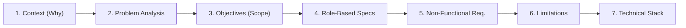
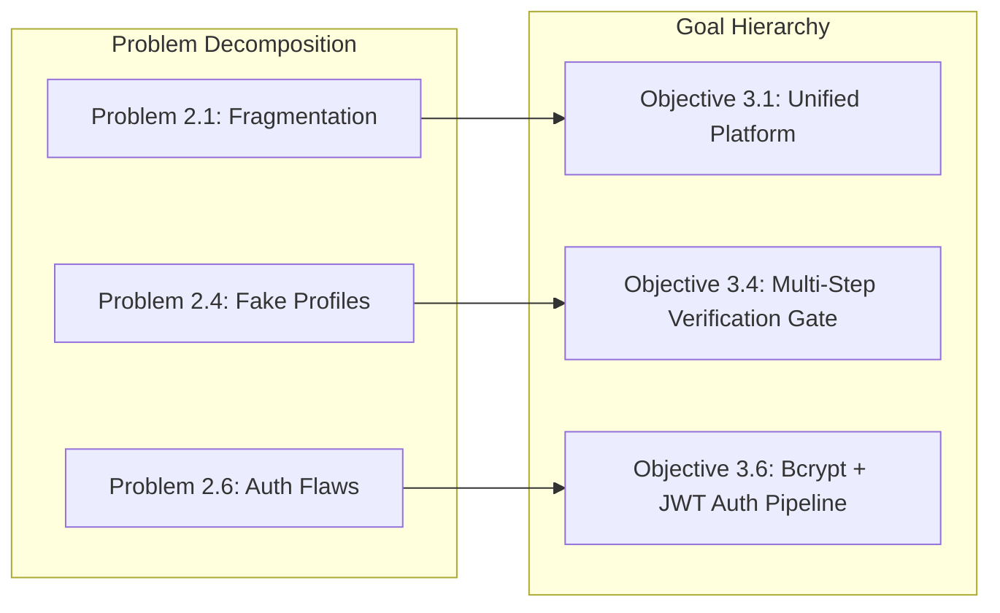
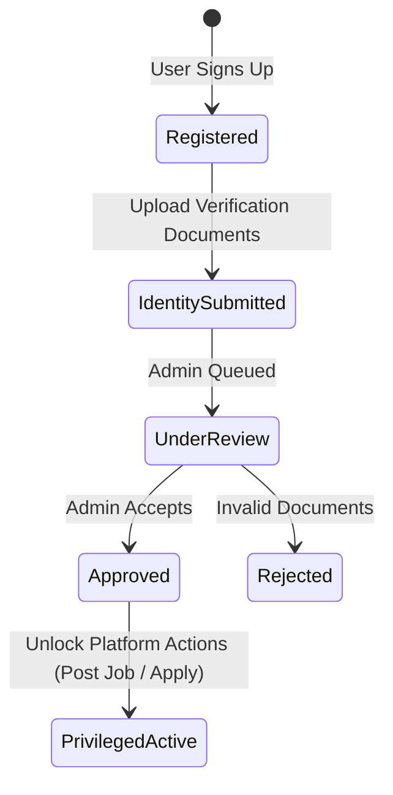

# Structural Blueprint & Writing Method: Problem-Driven Software Engineering Proposal

A briefing overview and architectural writing guide for engineering proposals, project defense reports, and technical specification documents.

---

## Executive Summary

The **Problem-Driven Software Engineering Proposal** is a structured technical writing methodology designed to eliminate ambiguity, demonstrate rigorous traceability, and ground technical decisions in verified user and business needs.

Rather than jumping directly to features or code, the document moves sequentially from the systemic root cause to operational capabilities, non-functional constraints, and technical governance.



---

## 1. Core Structure Breakdown

### Section 1: Context & Background (Introduction)
* **Purpose**: Establish domain context, highlight market fragmentation and workflow inefficiencies, and introduce the proposed solution as an end-to-end ecosystem rather than an isolated app.
* **Writing Formula (The Triad)**:
  1. **Status Quo (¶1)**: How the domain currently operates (fragmented channels, paper trails, manual coordination, administrative friction).
  2. **Pain Points & Escalation (¶2)**: Systemic vulnerabilities, trust deficits, fraudulent actors, scaling ceilings, and storage/data bottlenecks.
  3. **Proposed Vehicle & Ecosystem Scope (¶3)**: The centralized, secure platform introducing clear roles (e.g., User, Admin), core capabilities, and operational governance.

#### Reference Implementation: HireLink
> **¶1: Status Quo & Fragmentation**  
> The recruitment process is an essential activity, yet traditional methods remain highly fragmented, manual, and difficult to manage. Employers often scatter their job openings across various uncoordinated channels, forcing candidates to scour multiple platforms just to find suitable opportunities. This lack of centralization creates severe inefficiencies and administrative burdens for both organizations and job seekers.
>
> **¶2: Pain Points & Trust Deficits**  
> Beyond inefficiency, current systems suffer from significant security and trust issues. The absence of strict employer verification allows fraudulent or low-quality job advertisements to proliferate, eroding confidence in the overall hiring market. Additionally, relying on local or decentralized storage to manage CVs and applicant documents introduces critical vulnerabilities related to data accessibility, security, and scalability.
>
> **¶3: The Proposed Vehicle**  
> To address these systemic challenges, this project proposes the development of **HireLink**, a secure, mobile-based recruitment management system designed to centralize the hiring journey. The platform empowers job seekers to seamlessly search and apply for verified roles, while providing employers with intuitive tools to publish vacancies and efficiently manage applicants. Furthermore, dedicated administrators will ensure a safe ecosystem by verifying employers, moderating job advertisements, and maintaining robust platform security.

#### Project Adaptation: Bubble
> **¶1: Status Quo & Fragmentation**  
> Digital communication and community engagement are fundamental aspects of modern social interaction, yet conventional social platforms have become increasingly fragmented, noisy, and impersonal. Users are often forced to juggle disjointed messaging tools, overwhelming public feeds, and uncurated group forums just to maintain authentic relationships and shared-interest communities. This lack of focused organization leads to digital fatigue, context switching, and communication friction for both active community creators and everyday participants.
>
> **¶2: Pain Points & Trust Issues**  
> Beyond organizational clutter, mainstream social ecosystems face severe challenges regarding privacy, data governance, and trust. The unchecked proliferation of unverified profiles, intrusive algorithmic feeds, and insecure data handling degrades confidence in personal digital interactions. Furthermore, relying on fragmented third-party channels to exchange media, coordinate discussions, and store personal content introduces critical vulnerabilities surrounding data ownership, session security, and network scalability.
>
> **¶3: The Proposed Vehicle**  
> To address these systemic challenges, this project proposes the development of **Bubble**, a secure, fluid mobile-based community and messaging platform designed to centralize social spaces into intuitive, dedicated "Bubbles." The application empowers users to seamlessly discover and engage within interest-based communities, curate personalized content feeds, and communicate in real time through secure, end-to-end authenticated messaging channels. Supported by robust role-based moderation and cloud-native architecture, Bubble establishes a private, scalable, and verified ecosystem for modern digital connections.

#### Reusable Fill-in-the-Blank Blueprint
```markdown
[Domain/Activity] is a critical component of [Industry/Context], yet traditional methods 
remain highly fragmented, manual, and difficult to coordinate. [Primary Actors] frequently 
scatter their efforts across disconnected channels, forcing [Secondary Actors] to navigate 
multiple disparate tools just to accomplish [Core Objective]. This lack of centralization 
creates severe operational inefficiencies and friction for all stakeholders involved.

Beyond inefficiency, current approaches suffer from significant [Security/Trust/Integrity] 
vulnerabilities. The absence of [Verification/Standardized Controls] allows [Core Risk/Fraud/Errors] 
to proliferate, eroding confidence across the system. Furthermore, relying on [Legacy/Fragmented 
Infrastructure] to manage [Sensitive Data/Assets] introduces critical bottlenecks in data 
accessibility, confidentiality, and long-term scalability.

To address these systemic challenges, this project proposes the development of [Platform Name], 
a secure, [Platform Type, e.g., mobile/web-based] system designed to centralize and streamline [Core Workflow]. 
The platform empowers [Actor 1] to seamlessly [Action 1], while providing [Actor 2] with intuitive 
tools to [Action 2]. Furthermore, [Administrators/System Operators] ensure a safe, robust ecosystem 
by enforcing [Governance/Verification], maintaining platform security, and ensuring reliable data persistence.
```

---

### Section 2: Granular Problem Decomposition (Statement of the Problem)
* **Purpose**: Dissect broad industry challenges into orthogonal, discrete, numbered failure modes ($2.1$ through $2.n$).
* **Writing Pattern**: Each problem entry must address exactly **one** operational or technical failure:
  * **$2.1$ Lack of Centralization / Fragmentation**: Siloed tools, disconnected communication loops.
  * **$2.2$ Manual Inefficiency**: Human-bottlenecked workflows, repetitive data entry.
  * **$2.3$ Information Asymmetry**: Broken search, opaque application tracking, mismatched state updates.
  * **$2.4$ Trust & Verification Vulnerabilities**: Fraudulent actors, unverified credentials, forged profiles.
  * **$2.5$ Infrastructure Limitations**: Scalability bottlenecks, local vs. cloud storage constraints.
  * **$2.6$ Security & Authentication Weaknesses**: Insecure transport, weak password storage, absence of role enforcement.

---

### Section 3: Goal Hierarchy (General vs. Specific Objectives)
* **Purpose**: Establish strict **1:1 bidirectional traceability** between problems and proposed deliverables.
* **Structure**:
  * **General Objective**: A single overarching thesis statement summarizing the target deliverable.
  * **Specific Objectives**: Action-oriented deliverables using unambiguous imperative verbs (*Centralize*, *Automate*, *Verify*, *Encrypt*, *Persist*), mapping directly back to problems $2.1$ through $2.n$.



---

### Section 4: Role-Based Functional Specification (Actor-Oriented Architecture)
* **Purpose**: Define system behavior through user personas and permission tiers rather than unstructured screen inventories.
* **Key Components**:
  1. **Actor Taxonomy**: Explicit enumeration of actors (e.g., Job Seeker, Employer, Moderator, Super Admin).
  2. **Gatekeeping & Verification Workflows**: Multi-step state transitions required before elevated privileges are granted.
  3. **Role-Specific Capabilities**: Concrete functional operations exclusive to each role.



---

### Section 5: Quality Attributes (Non-Functional Requirements)
* **Purpose**: Specify production readiness, architectural constraints, and cryptographic guarantees.
* **Target Categories**:
  * **Security & Cryptography**: Specific algorithms (e.g., password hashing with `bcrypt` / `Argon2id`, TLS 1.3 in transit, JWT with short expiry + refresh rotation).
  * **Performance & Latency**: API response boundaries ($P95 < 200\text{ ms}$), database query index plans.
  * **Storage & Memory**: Local caching strategies, blob/cloud storage partitioning, asset compression.
  * **Access Control**: Role-Based Access Control (RBAC) enforced at middleware/controller level.

---

### Section 6: Retrospective Transparency (Limitations & Constraints)
* **Purpose**: Document missing features, third-party blockers, technical debt, or dropped scope with full technical candor.
* **Value**: Demonstrates engineering realism and risk awareness rather than overpromising.
* **Typical Inclusions**:
  * Incomplete third-party API integrations (e.g., payment gateways awaiting sandbox approvals).
  * Dropped features due to time, infrastructure, or hardware limits.
  * Known edge cases deferred to future iterations.

---

### Section 7: Implementation & Engineering Architecture
* **Purpose**: Outline source code management, engineering standards, and the concrete technical stack.
* **Core Pillars**:
  1. **Engineering Governance**: Monorepo/multi-repo structure, Git branching model (`main`, `develop`, `feat/*`), conventional commit standards, and pull request reviews.
  2. **Tiered Technology Matrix**:
     * **Presentation Layer**: Framework, state management, design tokens.
     * **Application / Backend Layer**: Language, runtime, API style (REST/GraphQL/gRPC).
     * **Persistence Layer**: Relational database, ORM/query builder, caching layer.
     * **Infrastructure & Hosting**: Containerization (`Docker`), CI/CD pipelines, reverse proxy.

---

## 2. Reusable Technical Proposal Template

| # | Section | Core Focus | Target Content & Deliverables |
|---|---|---|---|
| **1** | **Executive Summary & Context** | Domain baseline | Market context $\rightarrow$ Current workflow flaws $\rightarrow$ Proposed unified vehicle. |
| **2** | **Problem Statement** | Failure decomposition | 4–7 numbered, orthogonal issues (fragmentation, security, scale, UX). |
| **3** | **Project Objectives** | Scope definition | 1 General objective + itemized specific objectives mapping 1:1 to problem statements. |
| **4** | **User Roles & Functional Specs** | Actor behavior | Role hierarchy + gating state machine + granular role permissions. |
| **5** | **Non-Functional Requirements** | Quality benchmarks | Explicit crypto standards, latency budgets, scalability metrics, and RBAC rules. |
| **6** | **Scope & Known Limitations** | Engineering candor | Unimplemented modules, API bottlenecks, deferred requirements. |
| **7** | **Methodology & Tech Stack** | Execution governance | Git workflow + tiered language matrix + ORM/database + deployment environment. |

---

## 3. Writing Checklist & Best Practices

- [ ] **1:1 Traceability**: Does every specific objective in Section 3 resolve a problem defined in Section 2?
- [ ] **Persona-Driven**: Are features grouped by user class/permissions rather than arbitrary screen mockups?
- [ ] **Concrete Primitives**: Are non-functional requirements backed by concrete technical primitives (e.g., `bcrypt`, `P95 latency`, `JWT RBAC`) instead of vague claims like "the system is secure"?
- [ ] **Transparent Scope**: Are out-of-scope modules and technical hurdles acknowledged candidly?
- [ ] **Reproducible Architecture**: Can another engineer replicate your development and deployment environment based on Section 7?

